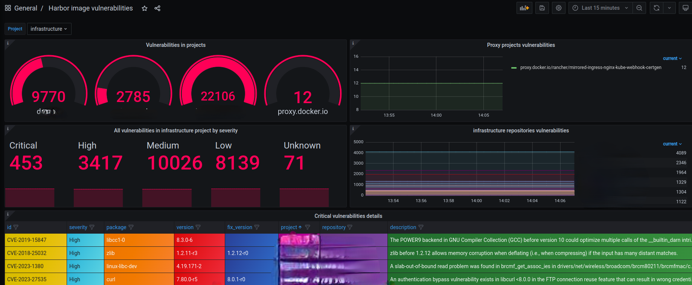

# Harbor Vulnerabilities Exporter
<p float="left">
  
  
</p>

The Harbor Vulnerabilities Prometheus Exporter is a Python script that collects vulnerability information for the latest pushed images in Harbor repositories and generates Prometheus metrics based on the collected data.

## Table of Contents

- [Introduction](#introduction)
- [Features](#features)
- [Installation](#installation)
- [Configuration](#configuration)
- [Metrics](#metrics)
- [Upgrading from 0.x](#upgrading-from-0x)
- [Usage](#usage)
- [Grafana dashboard](#grafana-dashboard)
- [Versioning](#versioning)
- [Contributing](#contributing)
- [License](#license)

## Introduction

Harbor is a container image registry that allows you to store, manage, and secure container images. The Harbor Vulnerabilities Exporter helps you gather vulnerability information for images stored in Harbor repositories and exposes this data as Prometheus metrics, making it easier to monitor security aspects of your images.

## Features

- Collects vulnerability information for the latest pushed images in Harbor repositories.
- Harbor is crawled in the background every `COLLECT_INTERVAL` seconds, scrapes are served from a pre-rendered (and gzipped) snapshot, so `/metrics` responds in milliseconds regardless of the Harbor size.
- Low cardinality by default: vulnerability counts per repository and severity are taken from the Harbor scan summary without downloading full scan reports.
- Optional per-vulnerability metric with severity, fixable and labels filters; descriptions are exposed once per vulnerability id.
- Supports parallel processing, retries and timeouts for Harbor API requests.
- Easily configurable through environment variables.

## Installation

Clone the repository:

   ```bash
   git clone https://github.com/NCCloud/harbor-vulnerabilities-exporter.git
   cd harbor-vulnerabilities-exporter
   ```

Install the required Python packages:

   ```bash
   pip install -r requirements.txt
   ```
For development (tests and linter) use `pip install -r requirements-dev.txt` and `make all`.

Set up your environment variables as described in the [Configuration] section.

Alternatively you can build a docker image for the harbor-vulnerabilities-exporter using the provided Dockerfile in the root of this repository:
   ```bash
   docker build -t my-image-tag .
   ```

## Configuration

You can configure the exporter using environment variables:

| Variable | Default | Description |
|---|---|---|
| `HARBOR_API_URL` | - | **Required.** API URL of your Harbor instance, for example: `http://harbor-harbor-harbor-core.harbor/api/v2.0` |
| `HARBOR_USERNAME` / `HARBOR_PASSWORD` | - | Harbor credentials (optional, a read-only robot account is enough). Without them only public projects are visible. |
| `EXPORTER_PORT` | `8000` | Port for `/metrics`, `/healthz` and `/ready` endpoints. |
| `COLLECT_INTERVAL` | `300` | Seconds between the starts of two Harbor crawls. It doesn't depend on the Prometheus scrape interval. |
| `THREADS` | `5` | Number of parallel Harbor API requests. |
| `REQUEST_TIMEOUT` | `30` | Timeout of a single Harbor API request in seconds, failed requests are retried 3 times. |
| `IGNORE_REPOSITORIES` | - | Comma separated list of `project/repository` to skip, for example: `project/repo1,project/repo2`. |
| `INCLUDE_PROJECTS` / `IGNORE_PROJECTS` | - | Regular expressions (full match) of project names to collect / skip, for example: `IGNORE_PROJECTS=proxy\..*`. |
| `DETAILED_METRICS` | `false` | Expose `harbor_image_vulnerability` with one series per vulnerability. |
| `MIN_SEVERITY` | `High` | Lowest severity of `harbor_image_vulnerability`: `Unknown`, `Low`, `Medium`, `High` or `Critical`. |
| `ONLY_FIXABLE` | `false` | Expose only vulnerabilities with a fix version in `harbor_image_vulnerability`. |
| `VULNERABILITY_LABELS` | `id,package,version,fix_version,severity` | Labels of `harbor_image_vulnerability` (`project` and `repository` are always set). Supported: `id`, `package`, `version`, `fix_version`, `severity`, `digest`. |
| `INCLUDE_DESCRIPTION` | `false` | Expose `harbor_vulnerability_info` with vulnerabilities descriptions (requires `DETAILED_METRICS` and `id` label). |
| `DESCRIPTION_MAX_LENGTH` | `0` | Maximum number of characters of a description, `0` means unlimited. For example: `1024`. |
| `LOG_LEVEL` | `INFO` | Logging level, `DEBUG` logs every repository. |

## Metrics

| Metric | Labels | Description |
|---|---|---|
| `harbor_image_vulnerabilities_total` | `project`, `repository`, `severity` | Number of vulnerabilities by severity in the latest pushed image. |
| `harbor_image_vulnerabilities_fixable` | `project`, `repository` | Number of vulnerabilities with a fix version. |
| `harbor_image_scan_status` | `project`, `repository`, `status` | Scan status (`Success`, `Error`, `Running`, ... or `not_scanned`), value is always 1. |
| `harbor_image_scan_timestamp_seconds` | `project`, `repository` | Time when the latest pushed image was scanned. |
| `harbor_image_vulnerability` | `project`, `repository` + `VULNERABILITY_LABELS` | One series per vulnerability, only with `DETAILED_METRICS=true`, filtered by `MIN_SEVERITY` and `ONLY_FIXABLE`. |
| `harbor_vulnerability_info` | `id`, `description` | One series per unique vulnerability id, only with `INCLUDE_DESCRIPTION=true`. |
| `harbor_exporter_collect_duration_seconds` | - | Duration of the latest Harbor crawl. |
| `harbor_exporter_last_success_timestamp_seconds` | - | Time of the latest completed Harbor crawl. If a crawl fails, the previous results are served. |
| `harbor_exporter_collect_errors_total` | - | Number of failed crawls, projects or repositories. |
| `harbor_exporter_api_requests_total` | `code` | Number of Harbor API requests by response code. |

Metrics always reflect the latest crawl: if a project or a repository can't be fetched, its metrics are absent until the next
successful crawl and the failure is counted in `harbor_exporter_collect_errors_total`. Only when the whole crawl fails (for example Harbor is down),
the previous results are served and `harbor_exporter_last_success_timestamp_seconds` shows their age.

The exporter also serves `/healthz` (liveness) and `/ready` (the first crawl is completed) endpoints.

Example queries:

```promql
# critical and high vulnerabilities by project
sum by (project) (harbor_image_vulnerabilities_total{severity=~"Critical|High"})

# details with descriptions joined by the vulnerability id, "or" keeps vulnerabilities without a description
harbor_image_vulnerability{severity="Critical"} * on(id) group_left(description) harbor_vulnerability_info
  or on(project, repository, id, package, version, fix_version, severity) harbor_image_vulnerability{severity="Critical"}

# repositories with new critical vulnerabilities comparing to the previous day
harbor_image_vulnerabilities_total{severity="Critical"} > harbor_image_vulnerabilities_total{severity="Critical"} offset 1d

# exporter can't collect data from Harbor for more than 30 minutes
time() - harbor_exporter_last_success_timestamp_seconds > 1800
```

## Upgrading from 0.x

Version 1.0 replaces `harbor_image_vulnerabilities` (one series per vulnerability with all the labels, including the description)
because of its cardinality: a Harbor with ~500 repositories produced ~250k series and a ~250MB response which took longer than the scrape timeout.

| 0.x query | 1.x query |
|---|---|
| `sum by (project, severity) (harbor_image_vulnerabilities)` | `sum by (project, severity) (harbor_image_vulnerabilities_total)` |
| `harbor_image_vulnerabilities{severity="Critical"}` | `harbor_image_vulnerability{severity="Critical"}` with `DETAILED_METRICS=true` and `MIN_SEVERITY` low enough |
| `description` label | `* on(id) group_left(description) harbor_vulnerability_info` with `INCLUDE_DESCRIPTION=true` |

Since scrapes are cheap now, use a scrape interval below the Prometheus lookback delta (5 minutes by default), for example `60s`,
otherwise instant queries may intermittently return no data.

## Usage

Run the exporter using the following command:

   ```bash
   export HARBOR_API_URL='http://your-harbor-endpoint'
   python3 exporter.py
   ```

or using container image:

   ```bash
   docker run -e HARBOR_API_URL='http://your-harbor-endpoint' -p 8000:8000 my-image-tag
   ```

### Helm chart

[Helm](https://helm.sh) must be installed to use the charts.  Please refer to Helm's [documentation](https://helm.sh/docs) to get started.

Once Helm has been set up correctly, add the repo as follows:

  ```bash
  helm repo add nccloud https://nccloud.github.io/charts
  ```

If you had already added this repo earlier, run `helm repo update` to retrieve the latest versions of the packages.
You can then run `helm search repo nccloud` to see the charts.

To install the exporter chart:

  ```bash
  helm install harbor-vulnerabilities-exporter nccloud/harbor-vulnerabilities-exporter
  ```

See [values](https://github.com/NCCloud/charts/blob/main/charts/harbor-vulnerabilities-exporter) for details.

## Grafana dashboard

Source code of the dashboard is included in the repository. Here is example of how it may look like:



## Versioning

We use [SemVer](http://semver.org/) for versioning.
To see the available versions, check [tags in this repository](https://github.com/NCCloud/harbor-vulnerabilities-exporter/tags).

## Contribution

We welcome contributions, issues, and feature requests!
Also, please refer to our [contribution guidelines](https://github.com/NCCloud/harbor-vulnerabilities-exporter/blob/main/CONTRIBUTING.md) for details.


## License
All functionalities are in beta and is subject to change. The code is provided as-is with no warranties.<br>
[Apache 2.0 License](./LICENSE)<br>
<br><br>
<br>
Made with <span style="color: #e25555;">&hearts;</span> by [Namecheap Cloud Team](https://github.com/NCCloud)
